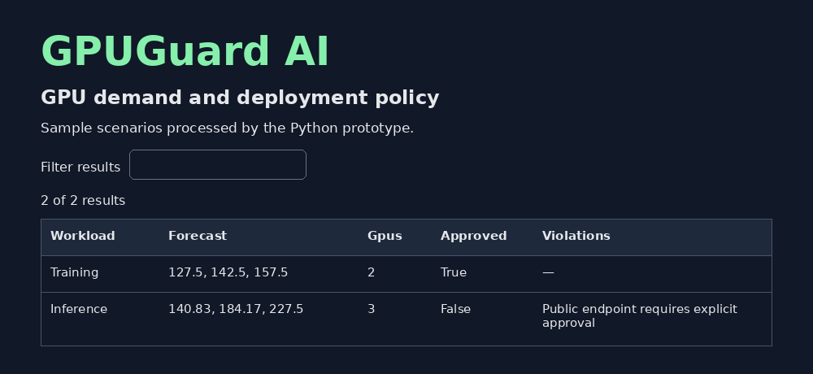

# GPUGuard AI

Estimate GPU demand and review deployment settings before allocating capacity.

[Open the live demo](https://lolstershwjav.github.io/gpuguard-ai/)

[](https://lolstershwjav.github.io/gpuguard-ai/)

## Try the demo

Enter `inference` in **Filter results**. The inference workload needs three GPUs under the demo assumptions and is flagged because it requests a public endpoint. The training workload passes the prototype checks.

## How it works

The forecast combines a recent average with a trend estimate. Capacity rounds up from peak projected demand. Separate rules flag privileged containers, public endpoints, missing digest prefixes, and nonpositive GPU counts.

The public demo filters precomputed results from synthetic examples. The Python prototype runs locally and requires no cloud credentials. Operational decisions require human review.

## Run locally

```bash
python3 demo_report.py
python3 -m http.server --directory docs
```

Open `http://localhost:8000` to preview the demo. To run the tests in a virtual environment, install `requirements.txt` and run `python -m pytest -q`.

## Deployment

GitHub Pages serves `docs/` from `main`. The preview image reproduces the demo’s published sample table.

## Roadmap

1. Add an optional LLM explanation adapter with schema validation and prompt-injection resistance.
2. Connect read-only cloud telemetry or ticket APIs with scoped credentials.
3. Build a FastAPI endpoint and TypeScript dashboard to collect user feedback and adoption metrics.
4. Add CI, structured logs, deployment documentation and measured before/after results.
